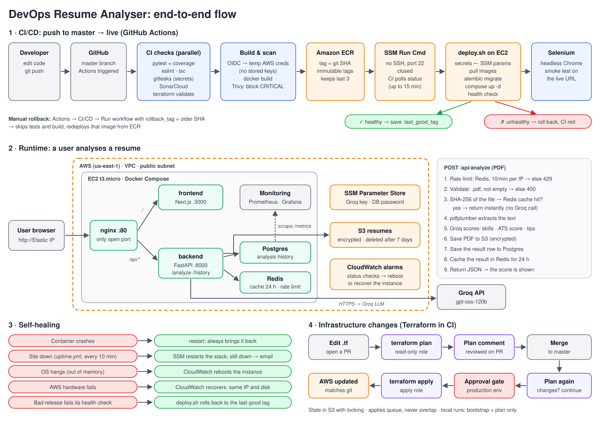

# Project flow (after a successful build)

What happens from the moment CI has built and tested a commit, through deployment, to a user request, and what keeps the site running afterwards.



```
push to master
   │
   ├─ CI checks pass (pytest, lint/tsc, gitleaks, SonarCloud, terraform validate)
   │
   ▼
1. Release   images built once, Trivy-scanned, pushed to ECR as <git SHA>
2. Deploy    SSM runs scripts/deploy.sh on EC2 → migrate → start → health check
                 ├─ healthy   → record as last good tag, done
                 └─ unhealthy → roll back to last good tag, CI job fails
3. Verify    Selenium tests run against the live URL
4. Serve     Browser → nginx :80 → frontend / backend → Postgres, Redis, S3, Groq
5. Heal      Uptime check every 10 min, CloudWatch alarms recover or reboot the host
```

---

## 1. Release: image to ECR

Job `build-and-deploy` in [.github/workflows/ci-cd.yml](.github/workflows/ci-cd.yml), on `master` only, after every check job passed.

1. GitHub Actions gets a short-lived OIDC token and assumes the `resume-analyzer-github-ci` role. No AWS keys are stored in GitHub.
2. For `resume-backend` and `resume-frontend`:
   - If `<repo>:<git SHA>` already exists in ECR, skip it. A re-run doesn't rebuild.
   - `docker build` (the frontend is built with `NEXT_PUBLIC_BACKEND_URL=/api`).
   - A Trivy scan fails the job on any fixable CRITICAL vulnerability.
   - `docker push`. ECR tags are immutable, so a SHA always means the same image. ECR also scans on push and keeps only the last 3 images.

## 2. Deploy: SSM to EC2

CI does not SSH anywhere (port 22 is closed). It sends an SSM Run Command to the instance:

```
cd /opt/devops-resume-analyser
git fetch --depth 1 origin master && git reset --hard FETCH_HEAD   # latest compose/nginx/scripts
scripts/deploy.sh <git SHA>
```

CI polls the command status for up to 15 minutes, prints the host's output, and passes only on `Success`.

What [scripts/deploy.sh](scripts/deploy.sh) does on the host:

| Step | Detail |
|---|---|
| Load config | `/etc/resume-analyzer.env` (region, ECR registry, S3 bucket), written once by `user_data.sh` at boot |
| Read secrets | Groq key, DB password and Grafana password from SSM Parameter Store (SecureString). Aborts if the Groq key is still `REPLACE_ME` |
| Write `.env` | Image tag + secrets, mode 600 |
| ECR login | Uses the instance role, no keys |
| Rollout | Pull backend/frontend → start Postgres + Redis → `alembic upgrade head` → `docker compose up -d` → restart nginx |
| Health check | Up to 30 × 5 s: `GET /api/health` **and** `GET /` through nginx |
| Success | Writes the tag to `.last_good_tag`, prunes old images, exits 0 |
| Failure | Prints `compose ps` and logs, re-runs the rollout with the tag in `.last_good_tag`, then **still exits 1**, so CI shows red while the site stays up on the old release |

## 3. Verify: smoke tests on the live site

Job `e2e-selenium` runs [tests/e2e](tests/e2e) with headless Chrome against `vars.APP_URL`. A failure here means the deploy succeeded but the live site is broken. Roll back manually (see §6).

## 4. Serve: a user request

```
Browser
  │  http://<Elastic IP>
  ▼
nginx :80   (only published port; Docker DNS re-resolved every 10 s)
  ├─ /        → frontend:3000   Next.js page
  └─ /api/*   → backend:8000    prefix stripped: /api/analyze → /analyze
                   │
                   ▼
              POST /analyze (PDF)
                1. Rate limit: Redis counter, 10 req/min per IP → 429
                2. Validate: .pdf, application/pdf, non-empty → 400
                3. SHA-256 of the file → Redis cache hit? return the cached result (no Groq call)
                4. pdfplumber extracts text
                5. Groq LLM → skills, ATS score, suggestions (502 if Groq fails)
                6. Store PDF in S3 (encrypted, deleted after 7 days)
                7. Save the result row in Postgres (analyses table)
                8. Cache the result in Redis for 24 h
                9. Return JSON to the browser
              GET /history  → past analyses from Postgres
              GET /health   → used by deploy.sh, the uptime check and the Docker healthcheck
              GET /metrics  → Prometheus scrape
```

Redis, Postgres and S3 are optional in code: each is off when its env var is unset, and Redis errors fail open (no cache or limit, the request still works).

Data stays private: Postgres and Redis sit on the internal Docker network only, the S3 bucket blocks public access, and the backend reaches S3 through the instance role (IMDSv2, hop limit 2).

## 5. Heal: keeping it up

| Layer | Trigger | Action |
|---|---|---|
| Container | Process crashes | `restart: always` restarts it; the backend has a Docker healthcheck |
| App | [uptime.yml](.github/workflows/uptime.yml): site fails 3 probes, every 10 min | SSM: `docker compose up -d` + restart nginx, then re-probe for 2 min. Still down → the run fails and GitHub emails you |
| OS | CloudWatch `StatusCheckFailed_Instance` for 3 min | Reboot the instance; Docker brings the stack back on boot |
| Hardware | CloudWatch `StatusCheckFailed_System` for 2 min | EC2 recover: same instance ID, Elastic IP and disk, on healthy hardware |
| Bad release | Health check fails during deploy | Automatic rollback to the last good tag (§2) |
| Cost | Spend or forecast above the budget | AWS Budgets email |

## 6. Rollback (manual)

Actions → **CI/CD** → Run workflow → `rollback_tag` = an older git SHA still in ECR (the last 3 are kept). The test and build steps are skipped; it goes straight to the SSM deploy with that tag.

## 7. Infrastructure changes

Separate from app releases, in [.github/workflows/terraform.yml](.github/workflows/terraform.yml), triggered by changes under `terraform/aws/`:

```
Pull request ── plan role (read-only) ── fmt → validate → plan ── plan posted as a PR comment
     │
  merge
     ▼
master ── plan ── changes? ── no  → done
                     │
                    yes → `production` environment waits for reviewer approval
                            → apply role → re-plan → apply
```

State lives in S3 (`resume-analyzer-tfstate-<account>`) with S3-native locking. Runs on `master` queue, so two applies never overlap.

## 8. Monitoring (optional add-on)

The `monitoring` profile (started by `deploy.sh`) runs Prometheus, Grafana and node-exporter, bound to `127.0.0.1` only. You reach Grafana through an SSM port-forward (the `grafana_tunnel` Terraform output). The dashboard shows request rate, p50/p95 latency, error codes, and host CPU/memory.

## Where each piece lives

| Concern | File |
|---|---|
| CI/CD pipeline | `.github/workflows/ci-cd.yml` |
| Terraform pipeline | `.github/workflows/terraform.yml` |
| Uptime / self-heal | `.github/workflows/uptime.yml`, `terraform/aws/cloudwatch.tf` |
| Host deploy + rollback | `scripts/deploy.sh` |
| Host bootstrap | `terraform/aws/user_data.sh` |
| Runtime stack | `docker-compose.prod.yml`, `nginx/nginx.conf` |
| CI roles (OIDC) | `terraform/aws/oidc.tf`, `terraform/aws/github_terraform.tf` |
| Secrets | `terraform/aws/ssm.tf` (SSM Parameter Store) |
| API | `backend/app/routes/analyze.py`, `backend/app/cache.py`, `backend/app/db.py`, `backend/app/storage.py` |
